<p align="center">
  
</p>

# Better Music Overlay

[](https://github.com/LootingVI/BetterMusicOverlay/actions/workflows/build.yml)
[](https://github.com/LootingVI/BetterMusicOverlay/releases/latest)
[](LICENSE)

**Your soundtrack. Your world.** A customizable, client-side Fabric music overlay with smooth typography, native media controls, album-inspired colors, and optional synchronized lyrics. All interface text is English.

**[Download the latest release](https://github.com/LootingVI/BetterMusicOverlay/releases/latest)** · **[Installation](#install)** · **[Lyrics setup](#lyrics)** · **[Report a bug](https://github.com/LootingVI/BetterMusicOverlay/issues/new/choose)**

Works with **Minecraft 1.21.11, 26.1, 26.1.1, 26.1.2, 26.2, and 26.3**. Native music integration currently requires **Windows 10/11**. Spotify, Apple Music, and browser players work when they expose a Windows media session; available controls depend on the player.

- **Make it yours:** four layouts, five themes, custom colors, adjustable dimensions, saved profiles, Vinyl and Lyric Lounge scenes.
- **Stay in the game:** artwork, player selection, playback controls, optional automatic collapse, and Minecraft music ducking.
- **Follow the words:** local LRC / Enhanced LRC, optional LRCLIB lookup, a full lyrics reader, and saved timing adjustments.
- **Choose what to share:** online lyrics are off by default; streamer controls can hide track details, lyrics, or selected players.

## See it in action

The cards below are rendered by the mod with original example track text. The reader image is captured in Minecraft; the cover above is promotional artwork.

<p>
  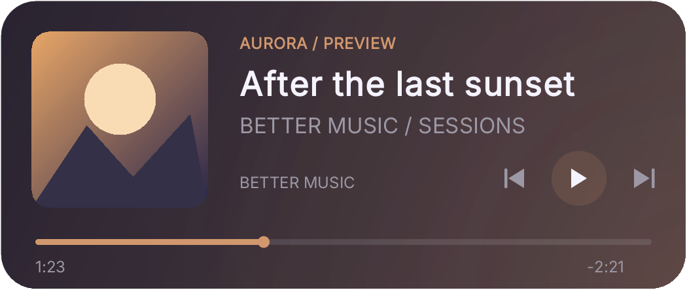
  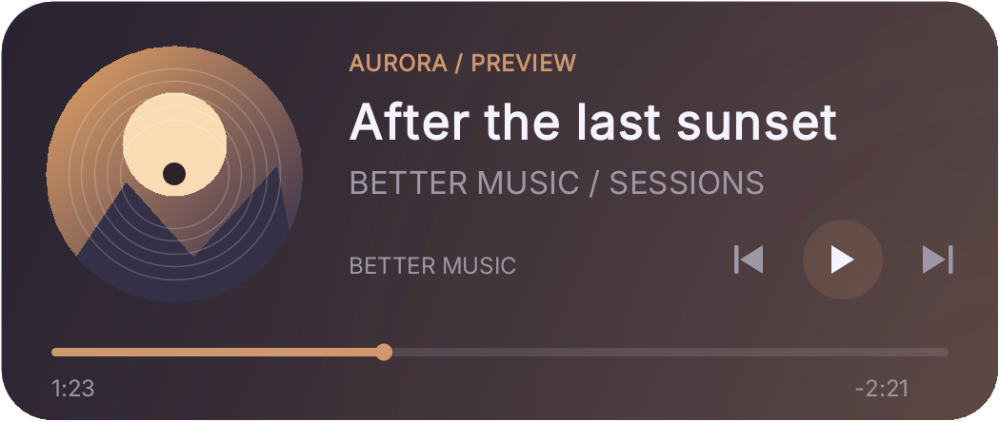
</p>

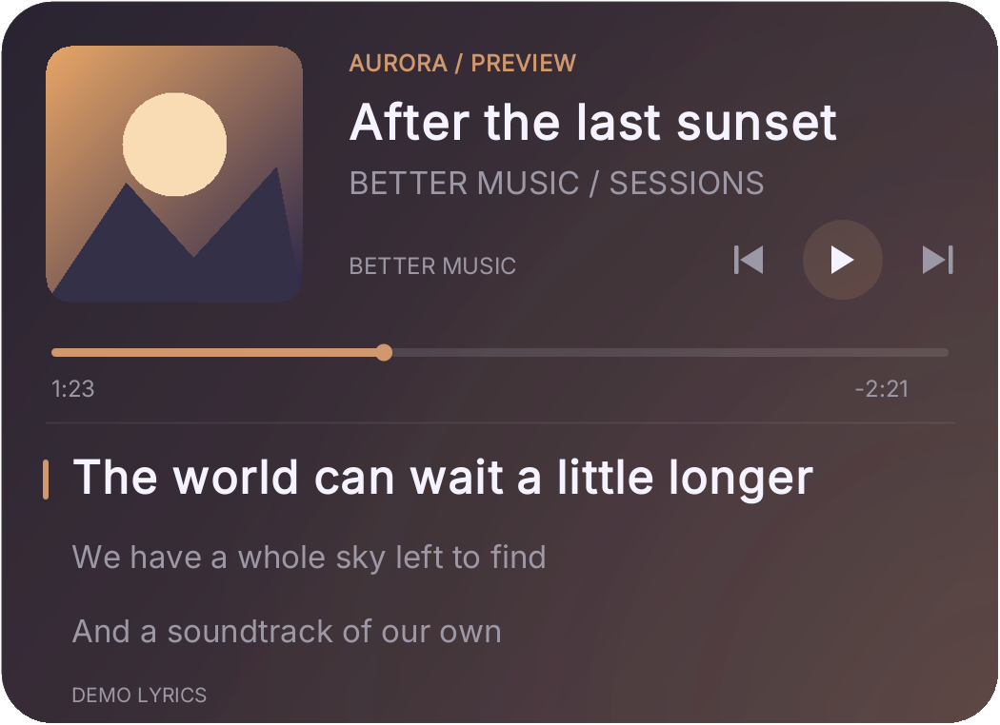

<details>
<summary>More screenshots: customization, lyrics reader, and privacy controls</summary>

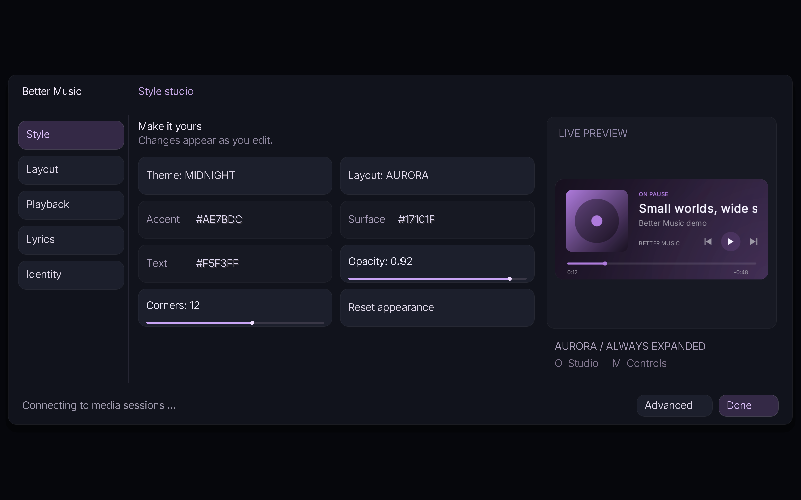
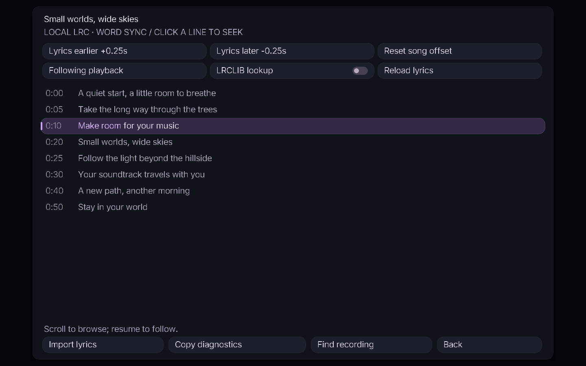
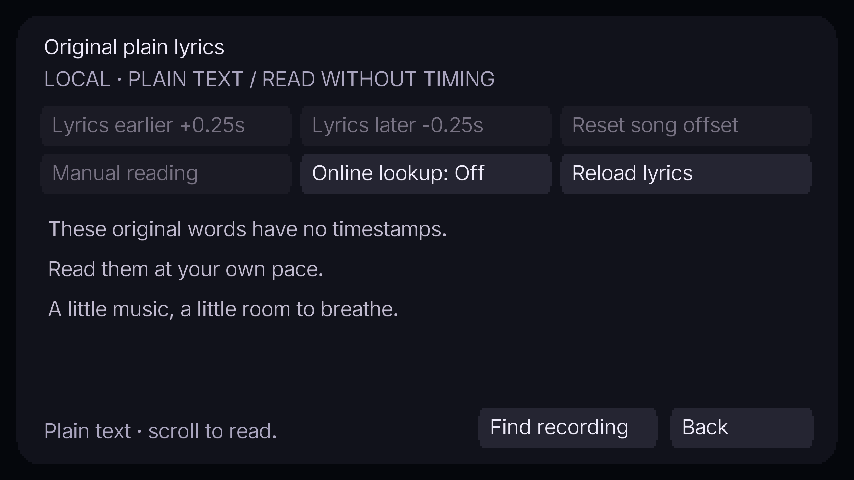
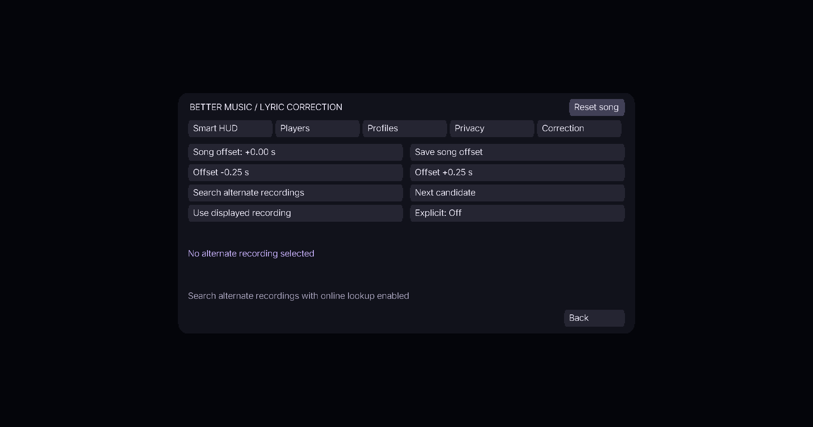
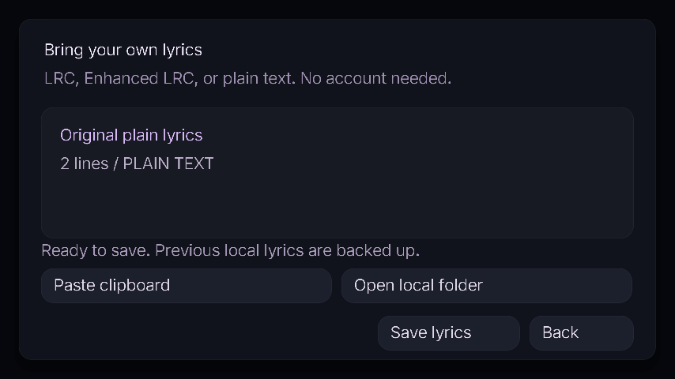
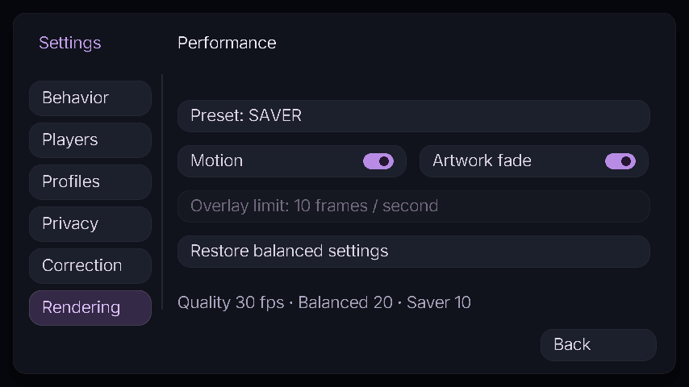

</details>

## New in 1.5 — motion for your music

Lyric lines now enter with a gentle slide and fade, with a focus surface behind the active line. The full reader smoothly follows playback and moves its focus marker between lines. When the source provides word timestamps, each word gets a short highlight reveal at its timestamp. Line-only and plain-text lyrics keep their original timing capabilities.

Album-colored light drifts behind the card, a moving halo traces the artwork, and Aurora's progress marker glows softly. These are decorative effects, not an audio spectrum or beat detector. Playback-linked artwork effects freeze when paused; Vinyl keeps its angle instead of snapping back.

Open **O → Playback → Motion settings**, or **Advanced → Motion**, to choose **Flow / Fade / Off**, set the intensity, and control ambient drift, artwork halo, word reveal, and track fades. The global **Motion** switch disables animation. Appearance profiles include the new settings; existing rendering limits still apply.

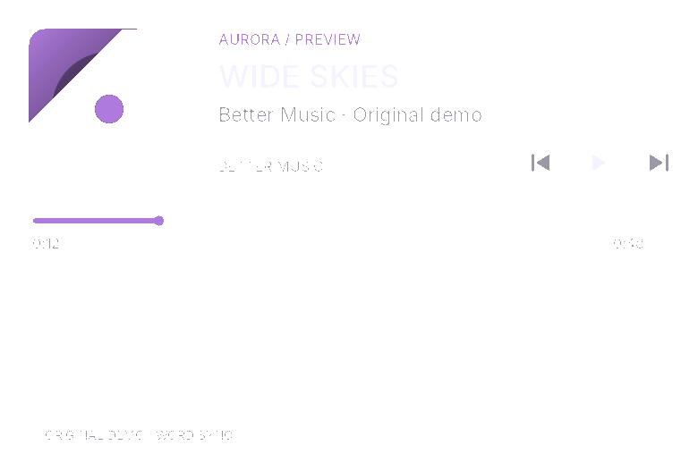

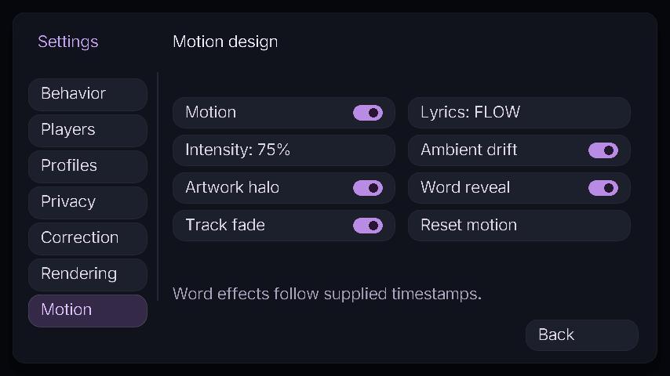

## Fixed in 1.4.2 — Apple Music on Windows sending the album inside the artist

Apple Music's Windows media session can send `Artist — Album - Single` as the artist while leaving its album field empty. Earlier versions queried LRCLIB with that combined artist and rejected the correct recordings. The lookup now recovers the artist and album for this player format, including album names containing an em dash. Local lyric filenames and saved corrections keep their existing identities.

**Find recording** also tries a title-only search when the artist search returns no records. This exposes entries filed under an artist alias or a different credit; choose **Use displayed recording** to save the match. Automatic selection continues to check title, artist, version, and known duration.

The lyrics reader has **Copy diagnostics** for the current track: mod version, raw player metadata, normalized search metadata, lookup status, and request results. The report excludes lyric text, artwork and local file paths; Streamer mode redacts track details. Nothing is uploaded by this button. Check the report before sharing it in a bug report.

## Fixed in 1.4.1 — lyrics hidden by album metadata differences

Apple Music can label an album with `- Single` or `- EP`, while LRCLIB stores the matching recording under another album spelling. The old lookup rejected those differences and repeated the album filter in its fallback search. For example, this hid the existing synchronized entry for **GERÄT (bitte cancelt mich 2)** by **Zensery**.

Fallback search now uses title and artist; album names help rank results instead of rejecting them. The title, artist, recording qualifiers, and available duration still have to match. Confirmed album text appended to the artist also tolerates the Single/EP suffix. If the player omits duration, the mod can accept a consistent set of matching results; conflicting recording lengths require **Find recording**. An unsuccessful automatic match now points to that action instead of suggesting that no lyrics exist.

## New in 1.4 — a redesigned studio and richer LRCLIB support

The studio now has sidebar navigation, rounded controls, switches, a dedicated live preview, and a compact layout for smaller windows. Advanced settings and the lyrics reader share the same visual style. **O → Advanced → Rendering** offers **Quality (30 fps)**, **Balanced (20 fps, default)**, and **Saver (10 fps)** limits for the overlay renderer. These limits do not change Minecraft's frame limit. With Motion off, unchanged cards skip painting.

Rendering reuses its image and upload buffers, caches the gradient background and UI surfaces, and uploads pixels in bulk. A local raster benchmark measured about **97% fewer Java allocations per frame** for a reused surface compared with allocating a fresh surface in the same renderer. This is a focused allocation measurement, not a claim about Minecraft FPS; see [performance notes](docs/PERFORMANCE.md).

**O → Lyrics → LRCLIB lookup** enables the online provider. The integration now reads the documented `lyricsfile` format, including supplied word timestamps, explicit line endings, line-synced lyrics, and plain text. The HUD and reader can highlight those words. Alternate recordings show **WORDS**, **SYNC**, or **PLAIN**; automatic matching still checks the recording metadata. Unsupported or malformed rich data falls back to the legacy LRC/plain fields.

**Import lyrics** accepts a dropped `.lrc` / `.txt` file or pasted text, previews its type, and saves it for the current track. Existing local lyrics receive a `.bak` backup. Plain text stays unsynchronized. Online access remains optional; no API key is needed for LRCLIB.

## New in 1.3 — layout fixes and a proper lyrics reader

**Fix for an overlay stuck in the simple layout:** choosing a layout in **O → Style**, resetting the appearance, or choosing an Identity scene now turns off Smart collapse. Your selected layout stays selected after leaving the editor and restarting Minecraft. The studio displays the selected layout and whether collapse is enabled. If you want automatic collapsing again, explicitly turn it on in **More → Smart HUD**; its countdown now restarts when you enable it or change the design.

The rendering cache now invalidates on the complete visual style and resolution, so toggling artwork, changing dimensions, and changing the GUI scale cannot stretch an old frame into a new design. Settings snapshots no longer serialize JSON during every HUD frame. Privacy-aware card dimensions also match the editor and its control hitboxes. Custom controls now use Minecraft's mouse-button constants, fixing dragging, resizing, seeking, and overlay transport clicks on 26.3 after its move to SDL button numbering.

**O → Lyrics → Open lyrics reader**, or **M → Open lyrics reader**, opens the complete transcript. Timed lyrics follow the current line; scrolling temporarily suspends following, and Resume following returns to playback. Click a timed line to seek, when supported by the selected player. The Earlier / Later controls immediately apply and save ±0.25-second song adjustments without downloading the same lyrics again. Positive offsets display lyrics earlier; negative offsets display them later. The reader can load lyrics while HUD lyrics remain off.

Plain lyrics from a matching LRCLIB record or a local `.txt` file are available for manual reading, labeled **PLAIN TEXT**. They never receive artificial timestamps, automatic line advancement, or seeking. Local text uses the same Artist - Title filename as LRC, with `.txt` instead of `.lrc`; LRC takes priority. The reader uses the same explicit online permission and streamer privacy controls as the HUD.


Other fixes: playback time no longer freezes when the app omits total duration; automatic player selection stays with the active playing session; playback commands target the displayed player; late artwork is retried; cancelled searches cannot republish stale candidates; switching off online lookup cancels searches even when HUD lyrics are off. LRC parsing now preserves timestamp-like text inside lyrics, groups simultaneous translation lines, and recognizes supplied Enhanced LRC line-end timestamps. Intros show a countdown, and supplied end markers clear highlighting during instrumental gaps.

### What informed the lyrics improvements

Reviewed the maintainers' documentation on 2026-10-11. These are design references; no implementation code was copied:

- [PhantomLyrics](https://github.com/Anngiie/PhantomLyrics): quick per-song timing adjustments, lyric-line seeking, and stable selection when several sources are active informed the reader controls and player routing.
- [Hum](https://github.com/basezero-projects/Hum): separate states for synchronized/plain lyrics, instrumentals, errors, and missing results informed clearer result handling. Its documented provider integrations are not included here.
- [MusicShow / LyricSync](https://github.com/ShuangJinl/MusicShow): demonstrates another Fabric 1.21.11 approach using timed LRC and a local service, with lyrics displayed in the world. Better Music keeps the compact HUD and adds a reader screen.

LRCLIB remains the online provider. This release adds neither third-party proxy services nor unofficial provider endpoints.

## New in 1.2 — an overlay that fits how you play

Open **O → Advanced** for these pages:

- **Smart HUD:** optionally collapse to Minimal after 2–30 seconds, expand again on a track change, and fade the whole card briefly when your character takes damage. Opening the editor or quick controls shows your full design. Damage fade detects damage, not nearby enemies.
- **Artwork transitions:** blend between decoded covers over 650 ms. Motion and Track fade switches control this effect.
- **Players:** choose a detected Windows media session or automatic selection. Refresh / next players cycles through longer lists. Unsupported media apps cannot be discovered by this backend.
- **Profiles:** save Building, Exploration, Streaming, and two custom appearance slots. Export/import theme JSON through the clipboard or keep the files in `config/better-music-profiles/`. Loading a theme preserves online consent, player selection, and privacy settings. The Streaming slot is an appearance preset slot; enable Streamer mode separately.
- **Privacy:** hide titles, artist, artwork and provider identity; hide all lyrics; or hide lyrics for tracks you manually mark explicit. Comma-separated player-ID fragments hide the entire card for matching players. There is **no automatic explicit-content classifier**: Hide all is the default lyrics privacy choice. Privacy applies to this mod, not to another app or an OS notification.
- **Correction:** save a per-recording offset up to ±30 seconds, mark a track explicit, or search and explicitly choose an alternative LRCLIB recording. The global offset adds to the saved song offset; positive values advance lyrics. Local LRC still takes priority. Reset song restores automatic matching. Only explicitly saved corrections persist, in `config/better-music-lyrics/corrections/`; no listening history is recorded.
- **Editor:** drag the bottom-right corner to resize; snap to screen edges or centers; use Undo for up to 30 move/resize edits in the current editor session.
- **Music ducking:** optionally lower only Minecraft's MUSIC category while the selected external player is playing, then restore its multiplier smoothly. Saved Minecraft volume settings remain untouched. Other mods manipulating the same category multiplier may conflict.
- **Word highlighting:** local Enhanced LRC and LRCLIB Lyricsfile timestamps highlight supplied words as they start. Standard LRC remains line synchronized; no word timing is guessed. Disable Word highlighting to use line display everywhere.

Example **original** Enhanced LRC content, stored with the same `.lrc` filename as ordinary local lyrics:

```lrc
[00:10.00]<00:10.00>Your <00:10.50>own <00:11.00>frequency
[00:13.00]<00:13.00>Stay <00:13.50>in <00:13.80>your <00:14.10>world
```

The local parser follows the inline word timestamp form documented by [QuickLRC's Enhanced LRC format guide](https://www.quicklrc.com/subtitle-formats/enhanced-lrc). Reversed timestamps and ambiguous repeated-line word stamps fall back to line display. Online lookup also reads [Lyricsfile 1.0](https://github.com/tranxuanthang/lyricsfile/blob/main/SPECIFICATION.md). Unknown versions fall back to legacy fields. The draft's unresolved `offset_ms` field is ignored; your explicit global and per-song offsets still apply.

## New in 1.1 — give your soundtrack an identity

Open **O → Identity** for four scenes:

- **Reference:** the original compact purple card.
- **Aurora:** larger artwork, clearer track hierarchy, source badge where space allows, dedicated transport controls, and an accent-colored timeline.
- **Vinyl:** a circular album record with subtle grooves and slow decorative rotation during playback. Disable Motion to stop animation.
- **Lyric Lounge:** Aurora with three lyric lines, a larger current line, and a colored focus marker.

**Album colors** extracts an accent from the cover, ignoring neutral/transparent pixels. **Ambient glow**, **Track fade**, and **Large lyrics** are independently switchable. Track changes and lyric changes use short fades; long lyric lines restart their scrolling when they become current. The original reference layout remains the default. Switching scenes preserves screen placement, preferred player, and online-lyrics permission.

Click the timeline in the studio preview or **M** controls to seek, if the current app supports seeking. Standard LRC remains line synchronized; Enhanced LRC supports supplied word timestamps. There is no simulated audio analysis.

## Install

1. Install **Fabric Loader 0.19.5 or newer** for your Minecraft version.
2. Install the matching **Fabric API** from https://modrinth.com/mod/fabric-api.
3. Download **one** matching `better-music-overlay-<minecraft>-1.5.0.jar` from [GitHub Releases](https://github.com/LootingVI/BetterMusicOverlay/releases/latest) and copy it into your instance's `mods` folder. Remove the previous Better Music JAR when upgrading. Local builds are packaged under `dist/1.5.0/`.
4. Start music in a desktop app or browser and launch Minecraft.

Separate builds are provided for **1.21.11, 26.1, 26.1.1, 26.1.2, 26.2, and 26.3**. Future 26.x releases are not automatically compatible. Minecraft 1.21.11 needs Java 21 or newer; the 26.x builds need Java 25 or newer.

**Media integration currently supports Windows 10/11.** It uses Windows Global System Media Transport Controls, without account credentials. Apple Music, Spotify, browser players, and other applications work when they publish a Windows media session. Artwork, timing, and available playback commands depend on the application. There are no provider-specific streaming APIs and the mod does not stream or download music. macOS and Linux media backends are not included.

## Controls

- **O**: open Music Studio. `/music` also opens it in-game.
- **M**: release the cursor into quick music controls. Click previous, play/pause, or next; press Escape to return.
- The studio preview's playback icons are clickable too.
- Set optional play/pause, next, previous, and overlay-toggle shortcuts in Minecraft's Controls menu.
- **Layout → Move overlay with mouse**: drag the card anywhere, then save or press Escape.

## Customize

Music Studio provides Studio, Aurora, Compact, and Minimal layouts; Midnight, Matcha, Rose, Paper, and Ocean themes; custom hex colors; opacity; corner radius; width; scale; relative screen position; artwork; progress; scrolling titles; and automatic hiding when no track is available.

The card uses bundled **Inter** typography and antialiased, resolution-aware rendering. Drawing is prepared off the render thread and capped by your Rendering preset: 30, 20, or 10 updates/second. With Motion off, change checks run at most five times/second and identical cards skip painting. Album artwork is decoded off-thread with size limits. The animated title is decorative and is not an audio spectrum analyzer.

Settings are saved in `config/better-music-overlay.json`. Invalid numeric settings are clamped to safe values. The optional preferred-app field matches part of the Windows app ID, for example `spotify`, `apple`, or `chrome`. Leave it empty for automatic selection. If the selected app is absent, the overlay remains idle instead of controlling another app.

## Lyrics

Open **O → Lyrics** and enable **Show lyrics**. Choose one to three lines and adjust the timing by up to ten seconds; a positive adjustment advances the displayed line.

- **Local:** click **Import lyrics**, drop a UTF-8 `.lrc` / `.txt` file or paste its contents, then click **Save lyrics**. You can also open the local folder from that screen and use **Copy LRC filename** in the Lyrics tab. Files belong in `config/better-music-lyrics/`. Local files take priority.
- **Online:** enable **LRCLIB lookup** to retrieve lyrics from [LRCLIB](https://lrclib.net/docs). This sends the current title, artist, available album, and duration to LRCLIB. It is off by default. Results are cached only in memory for the current game session. Word timing depends on the selected recording's data.
- Missing, instrumental, offline, and unsynchronized results show an honest status; the mod never invents lyric timing. Windows media sessions themselves do not provide the lyrics.

An example local file:

```lrc
[ar:Example Artist]
[ti:Example Track]
[00:00.00]An original opening line
[00:10.50]An original second line
[00:20.00]An original third line
```

The parser supports repeated timestamps, fractional seconds, blank instrumental sections, and `[offset:milliseconds]` metadata. Track matching depends on the metadata your player supplies; use local lyrics when a provider adds extra text to the artist or title.

### Lyrics sources and matching

Primary-source documentation checked on 2026-10-11:

- [LRCLIB official API](https://lrclib.net/docs): selected for this release. Provides line-synced LRC, plain text, and rich Lyricsfile data with word timing where available. Lookup requires title and artist; album and duration improve precision. No API key is required. Coverage and correctness vary by recording.
- [Musixmatch official API collection](https://www.postman.com/musixmatch-dev/musixmatch-apis/collection/pqm8o6w/lyrics-api): requires an API key. Consider a separate provider integration once access and applicable display terms are arranged. No private application tokens or unofficial endpoints are used here.
- [LyricFind Lyric Display](https://www.lyricfind.com/products/lyric-display): offers line- and word-synchronized display through its partner offering. Not integrated without an access arrangement.
- [lyrics.ovh project documentation](https://github.com/NTag/lyrics.ovh): documents plain-text output and aggregation from lyrics websites. It does not document synchronized timestamps, so it is not used as an automatic timing fallback.

Local LRC takes priority. Online lookup checks title, artist, and available duration within two seconds. Album spelling is a ranking preference; fallback search does not filter by album. Live/remix/acoustic qualifiers are retained. Without a player duration, search first prefers a matching album when available and accepts only results whose durations span no more than two seconds. Otherwise, choose the recording manually. Apple Music's Windows `Artist — Album` format also works when the album field is empty. For other players, an appended album must match independently supplied album metadata, allowing Single/EP suffix differences.

The card labels the source; **Lyrics → View lyrics source** opens the actual LRCLIB record when available. Requests identify this project, run sequentially with a 250 ms gap, and check HTTP status and content type before decoding JSON. HTTP 429 and 503 respect `Retry-After`, including waits longer than five minutes. Brief overloads get one retry; long cooldowns return immediately to keep the lyric worker responsive. Rich YAML uses a safe parser with size, depth, alias, and duplicate-key restrictions. No timing is synthesized from plain lyrics.

## Build and verification

Release 1.5.0 was verified on 2026-10-13: **73 tests per target, 438 passes, zero failures**. Four opt-in tests are skipped in regular builds; the raster benchmark and animated preview generator passed separately for this release. Motion regressions cover timestamp boundaries, seeking, Unicode measurement, frame-rate-independent smoothing, reduced motion, independent lyric-animation disabling, and appearance-profile persistence. In-game checks on 1.21.11 and 26.3 exercised the Motion controls, reader, diagnostics, import and rendering presets; compact screens and the HUD were visually inspected. All six release JARs passed metadata, dependency, smoke-harness exclusion and SHA-256 verification.

Release 1.4.2 was verified on 2026-10-13: 66 tests passed on each target (396 passes, zero failures). Two opt-in live LRCLIB tests passed separately; the Zensery check used the combined Windows artist/album field with an empty album field and loaded record 32429053. New regressions cover that metadata format, recovered album ranking, player changes, broader manual discovery, saved selections, and diagnostic privacy. Minecraft 1.21.11 and 26.3 checks exercised the reader and diagnostics clipboard action; the compact layout was visually inspected. All six JARs passed version/target, bundled dependency, smoke-harness exclusion, and SHA-256 checks.

Release 1.4.1 was verified on 2026-10-12: 58 tests passed on each target (348 passes, zero failures). Two optional live LRCLIB tests passed separately, including the reported Zensery case using Apple Music's public title/album metadata. Deterministic regressions cover album edition differences, missing duration, ambiguous recording lengths, and rejection of incorrect artists or versions. The six packaged JARs passed metadata, dependency, smoke-harness exclusion, and checksum checks. This fix changes lookup logic; the in-game UI checks below were performed for 1.4.0.

Release 1.4.0 was verified on 2026-10-11: 53 automated test cases passed on each of the six Minecraft targets (318 passes, zero failures). The opt-in network test and benchmark are skipped in regular builds; both passed separately. The live LRCLIB check exercised lookup, alternate-recording search, saved recording selection, and disabling online access. Word-sync parsing uses original deterministic fixtures. Development clients for 1.21.11 and 26.3 verified layout-button clicks, the selected HUD after the collapse deadline, lyric-reader timing buttons, file-drop import and saving, rendering presets, and compact screen layouts. The release JARs were checked for their Minecraft metadata, bundled font, native helper and YAML parser, exclusion of the smoke harness, and SHA-256 checksums.

Use a **JDK 25** installation to build all targets:

```powershell
.\gradlew.bat build
```

Outputs are in each target's `build/libs/`. `mc12111` uses remapped Mojang names; the 26.x targets use unobfuscated Minecraft classes. The shared source generator applies the small, explicit GUI/API naming differences in `build.gradle`.

The tiny Windows thumbnail helper is bundled. Rebuild it after editing `native/ThumbnailReader.cs` using the Windows .NET Framework compiler:

```powershell
.\scripts\build-native.ps1
```

Tests cover LRC ordering and supplied word timestamps, repeated timestamps, blank lines, offsets, seeking, playback time clamping, invalid configuration, safe filenames, Smart HUD timing, damage fade, ducking recovery, privacy redaction, safe profile imports, per-recording corrections, and rendering each layout with/without lyrics. The 1.3 regression suite also covers selected-layout persistence, playback with unknown duration, plain-text fallback, stale-search cancellation, immediate timing adjustments, translation grouping, and explicit lyric end markers. Rendering tests produce previews in `<target>/build/previews/`.

An optional development-only smoke harness opens the real UI, captures screenshots, and exits:

```powershell
.\gradlew.bat :mc12111:runClient -Psmoke
.\gradlew.bat :mc263:runClient -Psmoke
```

Never distribute artifacts built with `-Psmoke`. Use a normal `clean build` for release. The harness is excluded from normal builds.

## Troubleshooting

- Start playback before opening the overlay; some apps expose sessions only after playback begins.
- In browsers, media-session support depends on the browser and website. Enable the browser's media-key integration if disabled.
- An app may expose metadata but reject next/previous; this is reported in the studio status.
- If Windows PowerShell or WinRT access is restricted on your machine, the studio reports the bridge failure. Diagnostics are stored in `.better-music/bridge.log` within the game instance.
- No genuine background blur is claimed: the reference appearance uses a translucent purple gradient. Low-resolution artwork supplied by an app cannot be made detailed by the renderer.

Code: MIT. Inter: SIL Open Font License, included at `src/main/resources/assets/bettermusic/font/ofl.txt`. The bundled SnakeYAML 2.7 parser uses Apache License 2.0; its license is included at `META-INF/licenses/SnakeYAML-LICENSE.txt` inside each release JAR.

Artwork provenance and the cover-generation prompt are documented in [Artwork notes](docs/branding/ARTWORK.md). This is an independent project, not an official Minecraft, Spotify, or Apple product.
